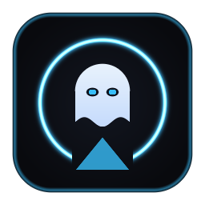

# 👻 GHOST MIRROR

**AirPlay Screen Mirroring Receiver for Windows (Ultra-Low Latency D3D11 + WASAPI)**  
*FAST · EDITION*



## Features
- **Zero-Bloat Native Win32 + Direct2D UI**: Dark-mode borderless HUD (`#09090B` Obsidian Zinc + Electric Indigo glow) with custom Ghost emblem and system tray support.
- **Hardware-Accelerated Rendering**: Powered by a customized UxPlay + GStreamer `d3d11videosink` pipeline with `-vsync no` for sub-frame mirroring latency.
- **Advance Custom Controls**:
  - **Presets**: Low Latency (`1080p60 H.264`), Sharp QHD (`1440p60 H.264`), Ultra 4K (`2160p60 H.265`), or **Custom Advance Tuning**.
  - **Custom Selector**: Cycle Resolution (`720p` / `1080p` / `1440p` / `4K`), Frame Rate (`30` / `60` / `120 FPS`), Codec (`H.264` / `H.265`), VSync (`Low-Lat` / `Smooth`), and View Mode (`Windowed` / `Fullscreen`).
- **Real-Time WASAPI Volume Slider**: Smooth `0% – 100%` per-process audio slider + instant mute without restarting the AirPlay stream.
- **Pure Screen Mirroring**: Patched AirPlay feature bits and RTSP/HTTP handlers to prevent unwanted HLS video-cast hijacks.

---

## Quick Start (Portable Release)
1. Download `GhostMirror-Portable.zip` from **Releases** and extract it anywhere.
2. Run **`GhostMirror.exe`**.
3. Connect your iPhone / iPad / Mac to the **same Wi-Fi / LAN** as your PC.
4. Open **Control Center** -> **Screen Mirroring** -> Tap **`Ghost`**.

---

## Building from Source
### Prerequisites
- **Visual Studio 2022 Build Tools** (MSVC `cl.exe` & `rc.exe`)
- **MSYS2 UCRT64** (`C:\msys64\ucrt64`) with `mingw-w64-ucrt-x86_64-gstreamer`, `gst-plugins-base`, `gst-plugins-good`, `gst-plugins-bad`, `gst-libav`, `openssl`, `libplist`.

### Build Commands
```bat
:: Build GhostMirror.exe UI + run self-tests
build.bat
```

## License
Released under the **GNU General Public License v3.0 (GPL-3.0)** (includes modified [UxPlay](https://github.com/FDH2/UxPlay) engine under GPLv3).
